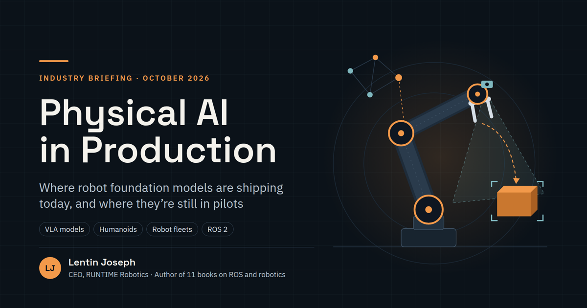

<div align="center">

# Physical AI in Production

**Where robot foundation models are shipping today, where they're still in pilots, and how to take one to production.**

[](https://runtimerobotics.github.io/physical-ai-in-production/)


[](https://runtimerobotics.github.io/physical-ai-in-production/)

An industry briefing by **Lentin Joseph**, CEO of [RUNTIME Robotics](https://github.com/runtimerobotics) and author of 11 books on ROS and robotics.

</div>

---

## About

*Physical AI* means AI models that perceive and act in the physical world: robot arms, humanoids, warehouse fleets and robotaxis. This briefing separates what is genuinely running in production from what is still in pilots or demos, and gives engineers a practical playbook for deploying a robot foundation model safely.

It is written for a mixed audience of robotics engineers, technical leaders and decision-makers. The content is technical where it matters: model architectures, evaluation, safety layers, on-robot inference and ROS 2 integration.

## Highlights

- **LLM vs. VLM vs. VLA** explained with one prompt answered three ways, plus how a VLA model is built.
- **Ten open-weight VLA models** you can download today, from OpenVLA to LingBot-VLA 2.0, with size, release date and license checked against their model cards.
- **Real deployments with evidence:** Amazon's 1M+ robots and DeepFleet, Agility Digit at GXO, Figure at BMW, and Waymo's 500k+ weekly paid rides.
- **The global picture:** China's humanoid shipment share and leading makers, and India's emerging Physical AI companies and policy.
- **An eight-stage production playbook:** spec and data, model choice, the evaluation ladder, a layered safety architecture, on-robot deployment, staged rollouts, a ROS 2 reference architecture and a readiness checklist.

## Viewing the slides

Open **[runtimerobotics.github.io/physical-ai-in-production](https://runtimerobotics.github.io/physical-ai-in-production/)** in any modern browser.

| Action | How |
|---|---|
| Next / previous slide | <kbd>→</kbd> / <kbd>←</kbd>, <kbd>Space</kbd>, the on-screen buttons, or swipe |
| First / last slide | <kbd>Home</kbd> / <kbd>End</kbd> |
| Link to a slide | Add `#n` to the URL, for example [`#11`](https://runtimerobotics.github.io/physical-ai-in-production/#11) |

## Contents

<details open>
<summary><b>01 · Foundations</b> (slides 3–8)</summary>

| # | Slide |
|---|---|
| [4](https://runtimerobotics.github.io/physical-ai-in-production/#4) | What "Physical AI" means |
| [5](https://runtimerobotics.github.io/physical-ai-in-production/#5) | LLM, VLM, VLA: what's the difference? |
| [6](https://runtimerobotics.github.io/physical-ai-in-production/#6) | How a VLA model works |
| [7](https://runtimerobotics.github.io/physical-ai-in-production/#7) | Three levels of maturity |
| [8](https://runtimerobotics.github.io/physical-ai-in-production/#8) | From pilots to paid work, 2024–2026 |

</details>

<details>
<summary><b>02 · The models</b> (slides 9–14)</summary>

| # | Slide |
|---|---|
| [10](https://runtimerobotics.github.io/physical-ai-in-production/#10) | Models powering real robots |
| [11](https://runtimerobotics.github.io/physical-ai-in-production/#11) | Open VLAs you can download today |
| [12](https://runtimerobotics.github.io/physical-ai-in-production/#12) | A new open VLA every few months |
| [13](https://runtimerobotics.github.io/physical-ai-in-production/#13) | Dream Labs: one brain, many robots |
| [14](https://runtimerobotics.github.io/physical-ai-in-production/#14) | Prompt a robot in plain language |

</details>

<details>
<summary><b>03 · Deployments</b> (slides 15–22)</summary>

| # | Slide |
|---|---|
| [16](https://runtimerobotics.github.io/physical-ai-in-production/#16) | Shipping today |
| [17](https://runtimerobotics.github.io/physical-ai-in-production/#17) | Amazon shows what scale looks like |
| [18](https://runtimerobotics.github.io/physical-ai-in-production/#18) | Humanoids: long pilots in factories |
| [19](https://runtimerobotics.github.io/physical-ai-in-production/#19) | Physical AI on the job: four videos |
| [20](https://runtimerobotics.github.io/physical-ai-in-production/#20) | Home robots: announced, not yet delivered |
| [21](https://runtimerobotics.github.io/physical-ai-in-production/#21) | China leads on humanoid volume |
| [22](https://runtimerobotics.github.io/physical-ai-in-production/#22) | India is building its Physical AI base |

</details>

<details>
<summary><b>04 · Market and hard problems</b> (slides 23–26)</summary>

| # | Slide |
|---|---|
| [24](https://runtimerobotics.github.io/physical-ai-in-production/#24) | Two business models are forming |
| [25](https://runtimerobotics.github.io/physical-ai-in-production/#25) | What makes deployment possible |
| [26](https://runtimerobotics.github.io/physical-ai-in-production/#26) | Why it's harder than chatbots |

</details>

<details>
<summary><b>05 · Taking a model to production</b> (slides 27–36)</summary>

| # | Slide |
|---|---|
| [28](https://runtimerobotics.github.io/physical-ai-in-production/#28) | The production loop |
| [29](https://runtimerobotics.github.io/physical-ai-in-production/#29) | Specify the job, then build the data |
| [30](https://runtimerobotics.github.io/physical-ai-in-production/#30) | Build, fine-tune or call an API? |
| [31](https://runtimerobotics.github.io/physical-ai-in-production/#31) | The evaluation ladder |
| [32](https://runtimerobotics.github.io/physical-ai-in-production/#32) | Bound the model, don't trust it |
| [33](https://runtimerobotics.github.io/physical-ai-in-production/#33) | Fit the model inside the control loop |
| [34](https://runtimerobotics.github.io/physical-ai-in-production/#34) | A Physical AI robot on ROS 2 |
| [35](https://runtimerobotics.github.io/physical-ai-in-production/#35) | Staged rollouts and the data flywheel |
| [36](https://runtimerobotics.github.io/physical-ai-in-production/#36) | Production-readiness checklist |

</details>

<details>
<summary><b>06 · Outlook and next steps</b> (slides 37–43)</summary>

| # | Slide |
|---|---|
| [38](https://runtimerobotics.github.io/physical-ai-in-production/#38) | What to watch in the next 12 months |
| [39](https://runtimerobotics.github.io/physical-ai-in-production/#39) | Key takeaways |
| [40](https://runtimerobotics.github.io/physical-ai-in-production/#40) | Get started this quarter |
| [41](https://runtimerobotics.github.io/physical-ai-in-production/#41) | Sources and caveats |
| [42](https://runtimerobotics.github.io/physical-ai-in-production/#42) | Sources for the latest checks |
| [43](https://runtimerobotics.github.io/physical-ai-in-production/#43) | Thank you and contact |

</details>

## Sources and methodology

- Every figure in the deck is cited on the two sources slides ([41](https://runtimerobotics.github.io/physical-ai-in-production/#41) and [42](https://runtimerobotics.github.io/physical-ai-in-production/#42)), with links to the original reports, company announcements, filings and model cards.
- Facts were checked against primary sources where available, for example Waymo's own blog, UBTech's stock-exchange filing, ISO's standards catalogue and Hugging Face model cards.
- Where trackers disagree, such as humanoid shipment counts, the slides show a **range** rather than a single number, and name the tracker used.
- Claims that could not be independently verified are labeled as claims. Research is current as of **October 2026**; robotics moves quickly, so check the linked sources before relying on a specific figure.

## Repository structure

```
.
├── index.html     # The complete slide deck: a single self-contained page
├── assets/        # Cover and share image, QR code, video thumbnails, demo screenshot
└── .nojekyll      # Serve files as-is on GitHub Pages
```

The site has no build step and no dependencies. Fonts load from Google Fonts. It is deployed automatically by GitHub Pages from the `main` branch.

## Third-party content

Company names, product names and trademarks belong to their respective owners and are used for identification only. Video thumbnails are stills or share images from the original publishers (BMW Group, Physical Intelligence, Agility Robotics and Amazon), and each links to the original video; no video footage is hosted here. The Dream Labs screenshot shows its public Robot Playground.

## Citation

If you reference this briefing, please cite it as:

> Joseph, L. (2026). *Physical AI in Production*. RUNTIME Robotics. https://runtimerobotics.github.io/physical-ai-in-production/

## License

© 2026 Lentin Joseph, RUNTIME Robotics. All rights reserved unless otherwise noted. To reuse or adapt this material, please get in touch through [RUNTIME Robotics on GitHub](https://github.com/runtimerobotics).
